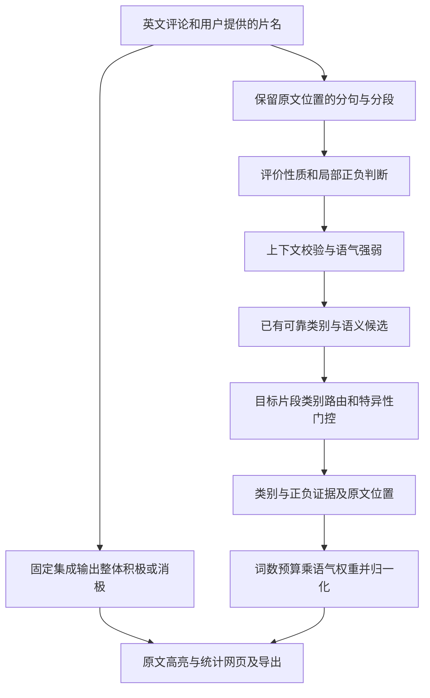

# 电影评论情绪分析与原因可视化技术说明

版本：`v0.2.0-research`，日期：2026 年 11 月 20 日。

本系统解决两个相互独立的问题：一是判断一条英文影评整体积极还是消极；二是找出评论中实际表达评价的原文片段，判断具体原因的类别、好坏与语气强弱，再展示原文高亮和加权组成。第二板块不把整体正负结果强行传播到每个句子，同一评论允许同时出现赞扬与批评。

本版发布当前可运行的本地研究应用及必要模型，不包含全部历史探索和原始标注库。原因分类虽有改善，尚未达到预先规定的正式精确率门槛。

## 1 项目来源与两个板块

原项目为 [IvoryGate/text-sentiment-analysis](https://github.com/IvoryGate/text-sentiment-analysis)。原有 `src`、`scripts`、`configs`、`notebooks`、`checkpoints`、`reports` 的职责继续保留。新增提交延续原 Git 历史，方便区分原始成果与后续开发。

第一板块服务于训练比较与报告。传统模型 B06、TextCNN、LSTM、BiLSTM、DistilBERT 以及投票集成的原始实验保留。接手后增加了评分加权二分类和评分分段辅助二分类。评分只作为训练监督，推理时只输入评论文本；当前网页不预测星级，也不把真实评分作为输入。

第二板块服务于使用者阅读分析结果。它复用第一板块的固定集成结果作为整体判断，单独运行原因分析链路。它不是把每个旧模型都再训练一次的对照实验，也不是无监督主题聚类。

## 2 整体积极消极分类

应用加载三个固定组件，输出积极类别的支持分数：

| 组件 | 表示与模型 | 应用权重 |
| --- | --- | --- |
| B06 | 原项目传统文本特征分类器，加载保存的 joblib 管线 | 0.20 |
| TextCNN | 词嵌入和多卷积窗口，加载原检查点及其词表 | 0.30 |
| DistilBERT | 经二分类训练的 Transformer 编码器 | 0.50 |

积极支持分数为 `s = 0.2 × s_B06 + 0.3 × s_CNN + 0.5 × s_DistilBERT`。当 `s > 0.5` 输出积极，否则输出消极。分数未经概率校准，不应解释成准确的“真实积极概率”。DistilBERT 使用最多 256 tokens，超长时输出截断标志；TextCNN 使用检查点保存的序列预处理参数。

在保留评分且可对齐的 24,670 条历史测试样本上，固定加权投票准确率约为 92.16%、F1 约为 0.9225。这是第一板块历史测试的共同样本回放结果，不是本次原因分类的准确率，也不是全新未接触测试集上的结论。完整对照见 `reports/tables/sentiment_comparison_with_rating_auxiliary.csv`。

### 2.1 评分监督实验

补齐并清洗后的评分为 1–4 与 7–10 分，没有 5–6 分中性样本；训练、验证、测试分别为 22,408、2,490、24,670 条。二分类标签与评分区间一致，但单句仍可能存在中性事实、反讽和局部混合评价。

评分加权方法采用 DistilBERT，将每条训练样本的二分类交叉熵乘以评分权重：`w(r)=1+0.5×(|r−5.5|−1.5)/3`，范围为 1–1.5。极端评分权重较大；与同初始化、数据顺序、训练轮数的普通交叉熵作对照。它改变损失函数而不增加评分输入特征。

评分分段辅助方法共享 DistilBERT 表示，使用一个二分类头和一个四分类辅助头，辅助区间为 `[1,2]`、`[3,4]`、`[7,8]`、`[9,10]`。损失为 `L = L_binary + λ × L_rating_band`，验证阶段选择 `λ=0.2`；对照使用 `λ=0`。统一训练 2 轮，长度 256，batch 16、累积 2，学习率 2e-5，使用 42、43、44 三个随机种子。评分头只在训练期间辅助，应用不输出它。

辅助实验三种子平均准确率：普通二分类约 91.4336%，辅助监督约 91.4471%，只提高约 0.0135 个百分点，远不足以宣称明显提升。原因可能包括评分与原正负标签高度重合、评分细分带来噪声、两轮微调容量有限；这些是解释假设，并非已证实因果。应用继续使用固定原集成，没有因微小优势替换第一板块。

## 3 原因标签与标注方式

固定 11 个原因大类。标签允许多选；“类别”与“好坏”分开保存。

| ID | 名称 | 主要边界 |
| --- | --- | --- |
| plot | 剧情与逻辑 | 叙事质量、逻辑、原创性、结局；剧情事件本身不算评价 |
| pacing | 节奏与剪辑 | 速度、长度、剪辑和节奏；泛泛无聊不一定属于此类 |
| acting | 演员表演与选角 | 表演、台词演绎和选角；颜值、角色道德不算演技 |
| characters | 人物塑造 | 人物写作、动机、发展、关系；人物做坏事不代表写得差 |
| dialogue | 对白与台词 | 书面台词内容、措辞、自然程度；听不清属于声音问题 |
| visuals | 画面与制作 | 摄影、动画、特效、服化道与视觉制作 |
| sound | 配乐与声音 | 配乐、歌曲、说唱、歌词、音效、混音与可听清晰度 |
| emotion | 情绪与类型效果 | 笑点、惊吓、悬念、感动等具体类型效果；总体喜欢不算具体原因 |
| theme | 主题与表达 | 思想、主题深度、信息表达；只是介绍题材不算评价 |
| adaptation | 改编与原作 | 将原作转换为电影的质量与忠实程度；普通作品比较不自动算改编 |
| other | 其他 | 前述范围外的具体制作或观看问题；不把所有无法判断的内容强行归入 |

先用外部大模型对约 2,000 条候选评论进行证据级标注、补标与复核，保留原文引文和来源。程序检查枚举、ID、重复和引文逐字匹配；机械通过不代表语义正确。域外、边界不清或反讽样本需要单独处理。标签是模型产生的弱监督，不是人工金标准，也不是完全无监督学习。

后续训练以目标片段为单位，叠加对照、明确无原因、自然片段等来源。当前特异性模型数据清单为 3,048 个片段记录：训练 2,984、开发 64；训练每轮呈现 5,744 次，包含自然片段重复采样，不能将其当成 5,744 条独立评论。开发集按评论分组，防止同一评论的不同片段跨入训练与开发。

## 4 单条评论推理链路



### 4.1 提取与局部正负

`reason_sentence_first.py` 按标点及从句边界拆分，并尽量保持共享主语、谓词和并列成分。每个片段记录原文 `start`、`end`、`quote`，始终要求 `text[start:end] == quote`。每个片段最多按 150 个 tokenizer tokens 分段，不将生成的解释当作原文证据。

公共 DeBERTa NLI 模型区分具体评价、总体态度、事实等性质，并估计局部正负。另一个在弱标签上训练的 NLI 模型提供 11 类 × 正负的 22 个支持分数。局部正负先要求明确支持及间隔；不足时可用较强的局部有符号类别支持回退，否则保留为不确定。不同模型分数只用于筛选，未经校准。

“很好，推荐”可保留为总体积极态度，但没有具体原因，不能据此虚构演技或剧情好评。剧情中发生可怕事件同样不能直接当作电影差评。整体积极与某个局部差评并不矛盾。

### 4.2 上下文、语气和初始类别

Qwen2.5-1.5B-Instruct 对目标片段作上下文校验，并在独立任务中选择轻微、普通或强烈的修辞强度。完整评论用于理解否定、指代与反讽，不允许借用其他句子的评价。语气尚无人工量表校准，属于序数估计。

初始原因需经过局部 NLI 支持、类别边界守卫及上下文 Yes/No 校验。基于公共 NLI 的语义排序对未获类别的情绪片段作候选补充。关键词与规则用于范围限制和易混边界；系统是神经模型、NLI、语义提示与规则组合，不能称为“纯神经网络、没有关键词分析”。

### 4.3 当前类别路由

`reason_router_v8.py` 使用 Qwen2.5-3B-Instruct。提示提供同一上下文、不同目标片段的成对示例，要求只判断当前目标，先区分具体原因、总体评价或事实，再返回固定类别集合。使用确定性生成并解析 JSON，长上下文和无效输出可以拒判。

自训练 `TargetReasonModel` 使用 DeBERTa 编码器，把目标 token 池化表示与首 token 表示拼接，经过 LayerNorm、Dropout，连接 11 类 sigmoid 头及一个“是否有具体原因”头。对未知标签采用遮罩损失，不能把未标注类别都当作负例。当前训练最多 4 轮，最佳开发损失在第 2 轮；编码器学习率 2e-5、头学习率 1e-4，batch 8、梯度累积 2，仅训练末 4 层，输入上限 224 tokens。

当前 v8 策略主要使用该自训练模型的特异性分数作门控：低于 0.5 不补原因；语义支持最低 0.25；候选采用并集模式，再经过类别边界检查。该策略不能与模型独立实验中的 0.975 阈值混为一谈，实际使用参数以 `selected_policy.json` 为准。

已经由前级可靠确认的类别保留；新路由只调整原因集合，不修改原文位置、局部正负、语气和第一板块权重。模块不可用时尝试保留前级结果，并返回回退信息；核心模型缺失或校验失败仍可能使任务失败，需要安装完整模型包。

## 5 占比算法与可视化解释

占比衡量本条评论中已确认原因证据的加权组成。对每个原文单词分配一个词数预算；若同时被多个不同“类别 × 正负”标签覆盖，则均分预算。同一标签多次覆盖同一词只保留最大语气权重，避免重复累计。

轻微、普通、强烈语气的权重依次为 1、1.5、2。令词 `t` 的标签集合为 `L_t`，该词对标签 `l` 的最大语气权重为 `w(t,l)`，则：

`credit(l) = Σ[t: l∈L_t] w(t,l) / |L_t|`

`share(l) = credit(l) / Σ[k] credit(k)`

例如两词普通演技好评的权重为 3，三词强烈剧情差评的权重为 6，占比分别为 33.3% 和 66.7%。该例只解释计算，不代表模型预测结果。同一类别好坏分别成扇区；同句同时涉及演技和音乐时不能重复扩大词数。

分母只包括获得支持的具体原因证据，不包括剧情事实、未确认片段和泛泛推荐。因此“演技好评 100%”可能只来自很短的一句，不代表整篇都是演技内容。界面同时提供覆盖信息；覆盖率不等于召回率。无具体原因时显示空统计，不捏造“其他 100%”。模型置信分数不参与此百分比，百分比也不是预测准确率或客观心理强度。

网页用颜色区分积极和消极，用字重及明暗表达估计的语气强弱，未识别情绪的原文保持普通样式。具体原因标签和饼图在后面展示；原文情绪高亮不保证每段都能进入具体原因统计。

## 6 应用接口与运行结构

`review_web.py` 使用 Python 标准库 HTTP 服务，只绑定本机环回地址。静态资源位于 `web/review/`。模型任务以子进程运行、单队列串行执行，避免多个 GPU 任务并发挤占显存。

| 接口 | 用途 |
| --- | --- |
| `GET /api/health` | 应用存活、语种、字符上限与类别信息 |
| `POST /api/jobs` | 提交片名和单条评论，返回任务标识 |
| `GET /api/jobs/{id}` | 查询排队和执行状态 |
| `GET /api/jobs/{id}/result` | 查询完成结果及类别字典 |
| `GET /api/jobs/{id}/report`、`GET /api/jobs/{id}/json` | 导出 HTML、JSON |

输入评论最多 12,000 字符，片名最多 160 字符，请求体受限。保存的评论文本不自动清洗重写，以便原文位置可追溯。当前英文检查是基本输入检查，并非完整语种识别。电影名称由用户提供，模型不执行电影识别、数据库匹配或自动翻译。

输出 JSON 保留 `overall`、`opinion_units`、`emotion_units`、`evidence`、`composition`、`reason_policy` 和试用状态。各证据含类别、正负、语气及原文位置。网页可导出阅读用 HTML 和机器可读 JSON；输入与结果保存在本机 `data/review_web/`。本版不提供账号系统、云端数据库上传或多人公网部署。

## 7 评估结果和解释边界

新一组 20 条评论含 156 个可评分目标，类别标签来源为独立分组后的模型复核；固定回归组有 117 个目标。以下为目标类别微平均，不是整篇电影情感准确率。

| 评估组与策略 | 精确率 | 召回率 | F1 | 无原因误报 |
| --- | ---: | ---: | ---: | ---: |
| 新评论组，旧策略 | 0.6667 | 0.2500 | 0.3636 | 4/91 |
| 新评论组，当前策略 | 0.7273 | 0.4000 | 0.5161 | 4/91 |
| 固定回归组，旧策略 | 0.9667 | 0.5321 | 0.6864 | 0/17 |
| 固定回归组，当前策略 | 0.9740 | 0.6881 | 0.8065 | 0/17 |

新组当前 TP=32、FP=12、FN=48，较旧策略的 TP=20、FP=10、FN=60 多找到了原因，但仍存在不少漏标和错误归类。预设验收要求包括新组精确率至少 0.80，因此正式验收未通过。之后选择可逆的本地试用，是综合改善后的工程判断，不得回写为“正式通过”。策略在该轮评估后没有据最终样本继续调参。

原评估还核验了引文逐字一致、评论分组隔离、策略与模型指纹固定，以及正面、负面、混合、泛泛四种实际推理样本和网页导出。工程测试验证数据与接口行为，不能据此宣称归类语义完全正确。公开版为避免散布原始语料，不附完整逐条评估文本，所以本次克隆能复现推理与工程测试，不能单凭公开包独立重跑整套私有标注评估。

## 8 安装 复现与版本控制

完整安装和命令见仓库 README。Python 固定为 3.12 系列。应用当前依赖 NVIDIA CUDA 和 BF16；已验证 8GB 显存设备，通过分阶段加载与必要的逐层 CPU/GPU 流式运行控制显存。CPU 内存、磁盘和网络也需预留；无法只用静态 GitHub Pages 承载推理。

`configs/model_assets.json` 保存训练附件与公共模型固定版本及 SHA256。自训练权重置于 Release ZIP，公共模型按固定 Hugging Face 提交下载：

| 模型 | 固定提交 |
| --- | --- |
| MoritzLaurer/deberta-v3-base-zeroshot-v2.0-c | `bddf8c5411c34ac3565e16e04384fd68b2618dda` |
| Qwen/Qwen2.5-1.5B-Instruct | `989aa7980e4cf806f80c7fef2b1adb7bc71aa306` |
| Qwen/Qwen2.5-3B-Instruct | `aa8e72537993ba99e69dfaafa59ed015b17504d1` |

安装脚本先验证附件，再提取允许的目标文件；逐文件检查哈希。运行校验清单覆盖实际推理代码、策略、模型与必要元数据，替代对历史实验目录的依赖。发布适配只涉及路径、校验清单、启动器和必要函数拆出；不更改模型权重、提示、阈值或网页美术。

```powershell
.\.venv\Scripts\python.exe scripts/install_model_assets.py --verify-only
.\.venv\Scripts\python.exe -m unittest discover -s tests -p "test_review_web.py"
.\.venv\Scripts\python.exe -m unittest discover -s tests -p "test_reason_composition.py"
```

切换回前级类别策略可将 `configs/reason_category_serving.json` 的 `active_policy` 设为 `semantic_backfill_v2`；原始保守策略为 `baseline`。受保护配置变更后需按实际变更更新完整性清单，不能通过删除校验绕过。只比较单次结果时优先使用命令行 `--reason-policy` 参数，无需改配置。

训练脚本与配置保存方法实现，但完整重训仍需要相应清洗数据和弱标签来源。下载本版不会触发重训；也不应从公开包中缺失的标注文件自行猜造训练标签。后续改动继续使用 `feat:`、`fix:`、`docs:` 等明确提交，源码、配置、评估结论分别可追溯。

## 9 局限与下一步

主要误差来自反讽、比较对象、script 指代、演技与人物写作边界，以及未明确表达原因的抽象评价。语气没有人工强度标尺，篇幅也不等于用户关切的重要性。二分类训练数据不含中性评分，故整体输出不能代表中性识别能力。多语言、电影自动识别、批量统计均未在本版验证。

下一步应先建立少量人工复核的固定目标片段集，重点覆盖上述边界，再评估原因精确率、召回率和无原因误报；对门控、类别与语气分别评估，避免一项改善掩盖另一项退化。加入新训练数据后应另留未接触评论作最终测试。模型与语料许可需逐项核查后再考虑商业使用，特别是 Qwen2.5-3B 的研究许可，不能从开源仓库推定为任意商业授权。
